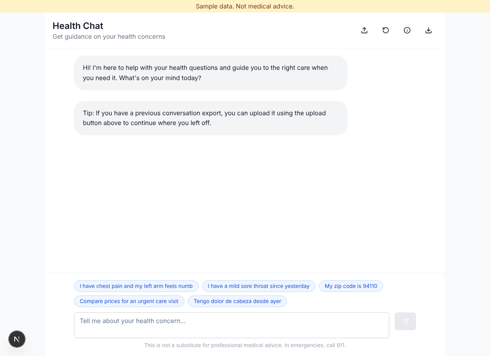
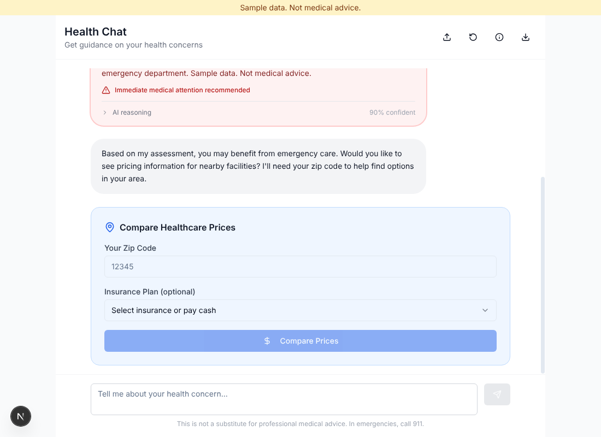
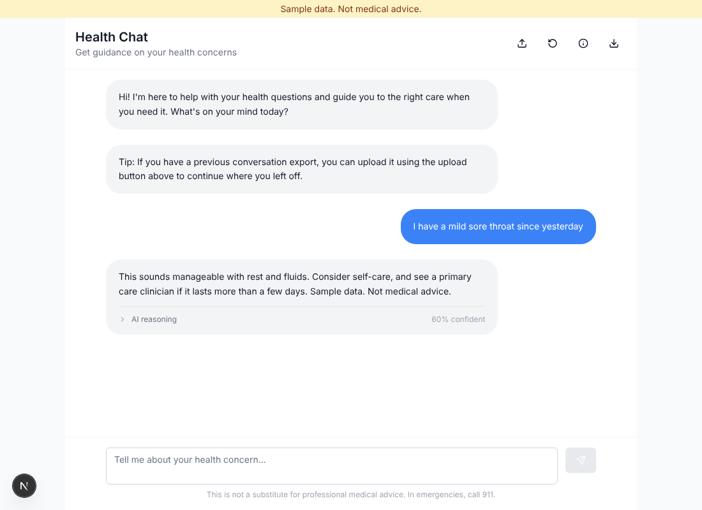
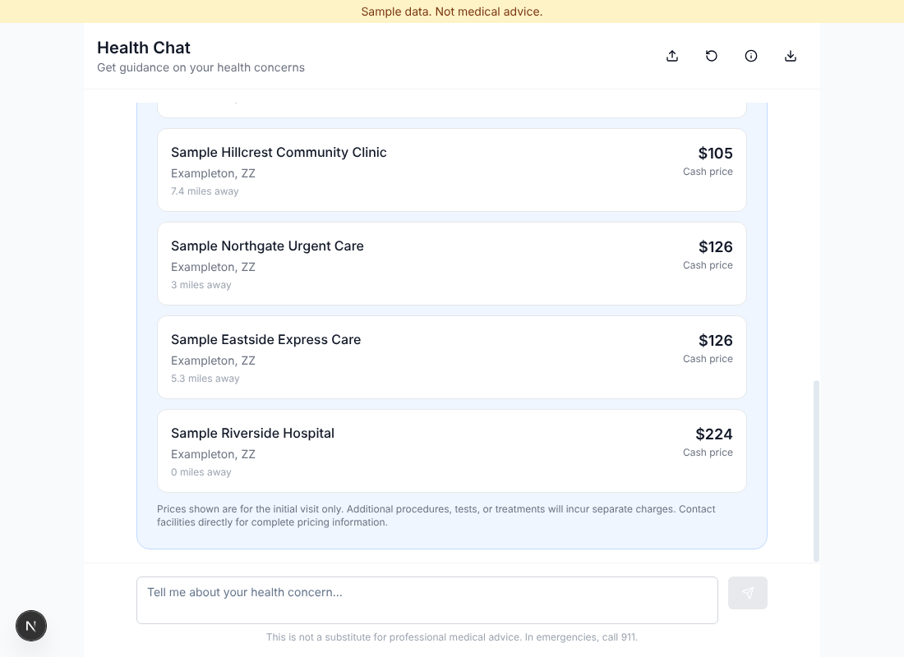
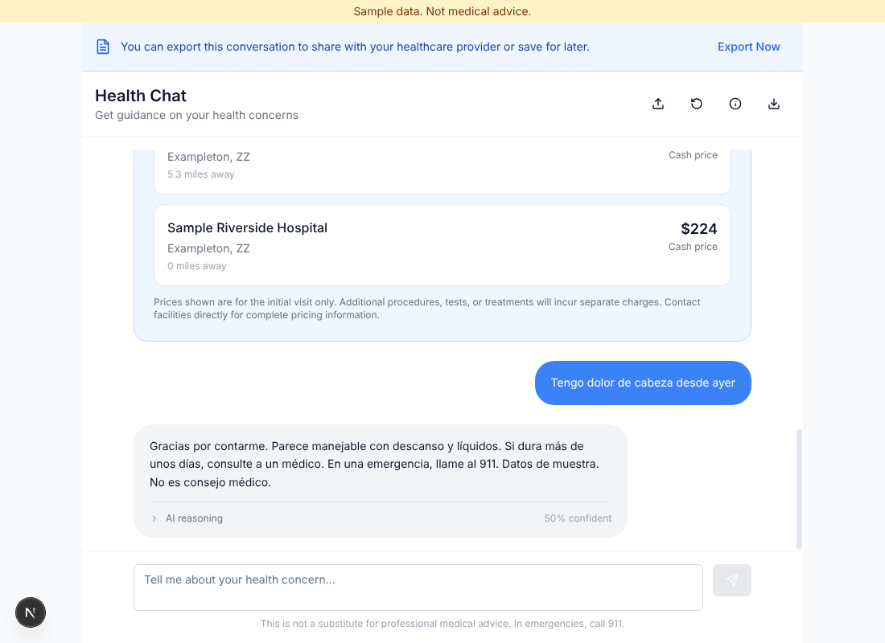

# Triage Chat

Sample data. Not medical advice.

A chat that asks about a symptom, suggests a care level (emergency, urgent, primary, self-care), and then lists nearby facilities with price estimates. Next.js 15, TypeScript, Tailwind. This is the newer of the two apps in the repo.

Status: work in progress.

## Screens

All screens carry the banner "Sample data. Not medical advice."











Sample prompts under the input send in one click: chest pain, a mild symptom, a zip code, a price question, and a Spanish message.

## Run it

Demo mode is the default. No credentials and no network are needed.

```
npm ci
npm run dev
```

The app is at http://localhost:3001. Production build and start:

```
npm run build
npm start
```

Tests (jest, mock backend, no network):

```
npm run test:jest
```

## Demo mode

Every call that leaves the process goes through `src/lib/backend/`:

- `types.ts`: the three interfaces (triage LLM, geocoding, prices).
- `mock.ts`: the default. Rule-based replies (Spanish text gets a Spanish reply), any five digit zip resolves to one sample region, prices come from `fixtures/`.
- `live.ts`: the real implementation (Google Generative AI, Google Geocoding, a Snowflake price source). Not tested here. The price source it was written against is retired.
- `index.ts`: picks one. `BACKEND_MODE=live` selects live; anything else selects the mock.

Fixtures in `src/lib/backend/fixtures/` are invented. Facility names, addresses and prices are sample data.

Environment variables for the live path are listed in `.env.example`.

## Known gaps

12 jest suites are skipped as 'feature not built'. Detail also in tests/SKIPPED.md.

Each suite below is marked `describe.skip` with the title prefix `[feature not built]`. No test was deleted.

| Suite path | Feature | Reason |
| --- | --- | --- |
| tests/unit/feature-flag-core.test.js | feature flags | feature not built. Evaluator, segmentation, rollout and A/B engine APIs do not match src/lib/feature-flag-core.ts. |
| tests/integration/feature-flag-management.test.js | feature flags | feature not built. No src/app and no feature-flag-management module. |
| tests/failure-modes/feature-flag-emergency-controls.test.js | feature flags | feature not built. No feature-flag-emergency-controls module. |
| tests/unit/localstorage-utility.test.js | local storage utility | feature not built. Encryption, PHI blocking and audit behavior are not in the demo utility. |
| tests/integration/localstorage-utility-integration.test.js | local storage utility | feature not built. Same gaps as the unit suite. |
| tests/unit/progressive-disclosure.test.js | progressive disclosure | feature not built. No progressive-disclosure UI component. |
| tests/integration/progressive-disclosure-integration.test.js | progressive disclosure | feature not built. No progressive-disclosure component and no TriageChat component. |
| tests/failure-modes/progressive-disclosure-failures.test.js | progressive disclosure | feature not built. No progressive-disclosure component. |
| tests/unit/memory-display.test.js | display components | feature not built. Expectations do not match the demo MemoryDisplay. |
| tests/unit/reasoning-display.test.js | display components | feature not built. Expectations do not match the demo ReasoningDisplay. |
| tests/integration/mcp-orchestrator-integration.test.ts | orchestrator | feature not built. The MCP SDK client is not installed. |
| tests/integration/component-state-storage-integration.test.js | chat component state integration | feature not built. No TriageChat component and no stateful triage route. |

Open: the price card says 'Found 6 facilities' but lists 5.

## Test status

Jest: 6 suites pass, 12 skipped, 0 fail. 83 tests pass, 278 skipped, 0 fail. Earlier baseline: 96 passed, 54 failed in 13 suites.

## Known issues

- `npm run typecheck` reports type errors in code the demo does not use. `next.config.js` skips type checking and linting during the build.
- A zip code or a price question in the chat opens the price form locally and does not call the triage backend.
- The price card header can count more facilities than the five it lists.
- Several `src/lib` modules (orchestrator, MCP config, enhanced Supabase client) are not reachable from the demo UI and are untested here.
- `supabase/functions` holds the edge functions of the earlier backend. Not tested here.

## Docs

Design notes: `docs/ARCHITECTURE.md`.
